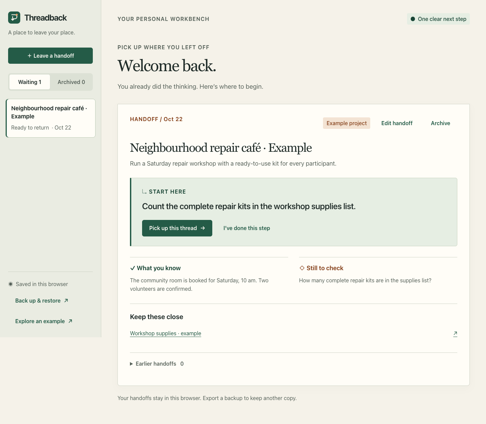

# Threadback — Your next step, waiting for you.

**Leave a clear handoff. Come back ready to act.**

Threadback keeps your goal, confirmed context, open questions, and next move together. Pause with a useful note to your future self. Return to a focused starting point, record what changed, and carry the thread forward.



## A place to leave your place

**A clear next move, with the context behind it.** Each handoff separates what you know from what you still need to check. Your next action gets the spotlight, with reference links close at hand. An optional five-minute timer gives that action a focused starting window.

**Progress that keeps its history.** Finish a step, record the result, and leave the next move. Earlier handoffs retain the completed action, confirmed context, and open questions, so you can follow how the work developed.

**Your work stays with you.** Start without an account or API key. Handoffs live in the current browser, with downloadable backups and validated restoration to carry them to another one.

## Watch the demonstration

[Watch the 77-second demonstration on YouTube](https://youtu.be/tEfidafjJiY). A [downloadable copy](evidence/Threadback-final-demo.mp4) is included. This edited recording shows the running application, including the example inventory, the recorded result, and the retained context.

## Try the complete loop

1. Choose **Explore an example** to open the repair-café project.
2. Select **Pick up this thread** and open its workshop supplies reference.
3. Count the complete kits, then select **Already done? Record progress** to save your result and next action. Or start the optional five-minute focus step and finish with **Done — what’s next?**
4. Expand **Earlier handoffs** to see the context you carried forward.
5. Open **Back up & restore** to download your saved threads.

The included example is fictional practice data. You can also create a handoff for your own work immediately.

## Run locally

Requires Node.js 22 or later and a modern browser.

```sh
npm start
```

Open `http://127.0.0.1:4177`. The server binds only to `127.0.0.1`. To change the port, run `PORT=4178 npm start`. Browser storage is tied to the exact origin, so a different hostname or port has separate saved handoffs. Serve the app over HTTP instead of opening its HTML file directly.

The application uses plain HTML, CSS, and JavaScript. No dependency installation or API key is needed for runtime use.

## Check and build

```sh
npm test
npm run check
npm run build
```

Core checks run without installing packages. For browser checks, run `npm ci`, start the app, then run `npm run test:browser` (installed Google Chrome is used). Tests cover core data behavior. Syntax checks do not validate visual behavior. Build replaces `dist/` with a copy of `app/`; it does not deploy. See [verification evidence](evidence/ACCEPTANCE.md) and [the build checklist](devpost/checklist.md).

## Storage and backup

Handoffs are stored in this browser origin under `threadback.v1`. Use **Back up & restore** to download a JSON copy. Restore validates the chosen file and shows its thread count before asking to replace the current collection; it does not merge collections. Keep a current export before replacing data.

Limits are 200 threads, 500 history entries per thread, 8 reference links per thread, and a 2 MB backup. The editing form exposes the first reference and preserves additional imported references. Unreadable local data has a recovery-download path and an explicitly confirmed reset. A stale tab is instructed to reload before saving.

## Local privacy behavior

There is no application backend, analytics, account system, or runtime network API. Notes stay in browser storage until the user exports them or clears that storage. Backups are unencrypted files; keep them wherever their contents may safely be stored. Opening a reference navigates to the chosen destination. Browser storage can be cleared by browser settings or private-session behavior, so it is not a substitute for a separate backup.

The repair-café example and its inventory are fictional practice data. Their quantities are not user research or product-effectiveness measurements.

## Data shape

```text
{ version: 1, handoffs: [
  {
    id, title, goal, confirmed, uncertain, next,
    clues: [{ label, url }],
    createdAt, updatedAt,
    status: "parked" | "archived",
    history: [{ completed, confirmed, at, previousConfirmed?, previousUncertain? }]
  }
] }
```

Title is limited to 120 characters; goal, confirmed context, uncertainty, and next action to 2000 each. Title, goal, confirmed context, and next action are required. Reference labels are limited to 120 characters and URLs to 2048. Only absolute HTTP/HTTPS reference URLs without credentials or control characters are accepted. Backup restoration validates structure and returns recognized fields only.

## Code layout

- `app/src/core.js`: validation, next-step hint, immutable creation/progression/archive, backup serialization.
- `app/src/app.js`: browser views, forms, storage, focus timer, and import/export interaction.
- `app/example.html`: synthetic reference page for the sample handoff.
- `tests/core.test.mjs`: core regression tests.
- `scripts/server.mjs`: local static server.
- `scripts/build.mjs`: static artifact copy.
- `devpost/`: draft planning documents and verification record.

New progress entries retain the previous confirmed context and uncertainty. Those fields are optional when importing older backups. The next-step hint uses a small wording heuristic and does not assess whether a task is actually complete or a statement is true. Timer state is session-only and does not automatically record progress.
